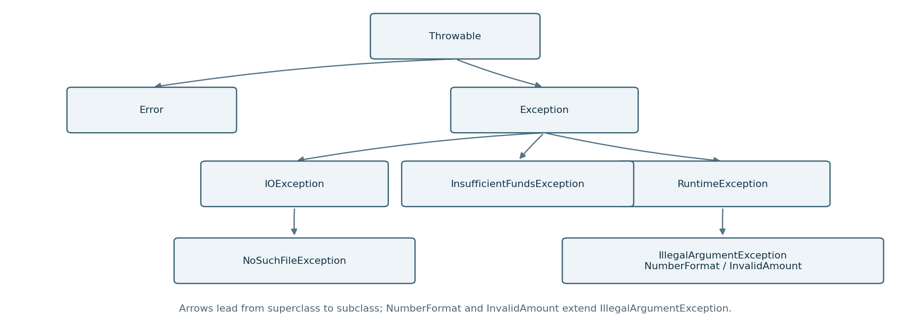
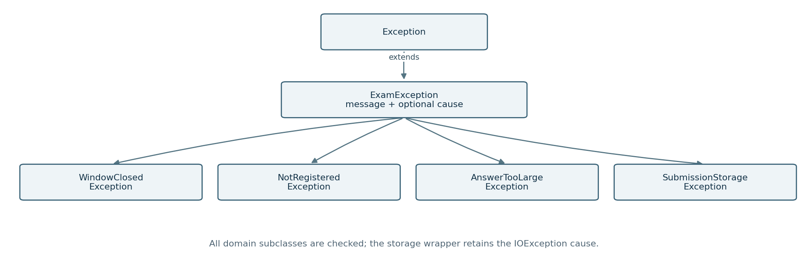
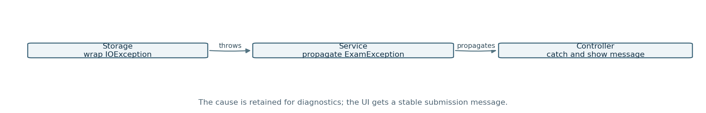
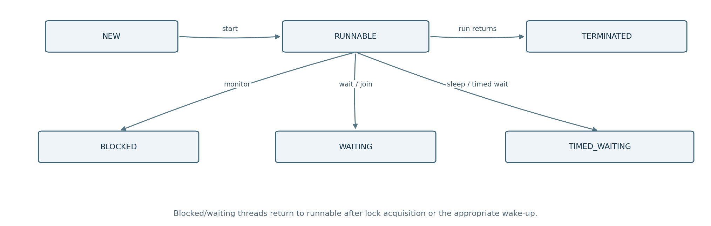
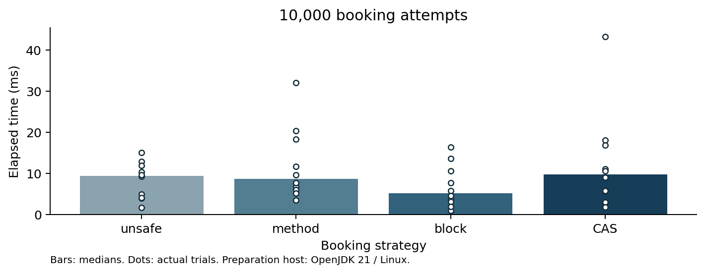
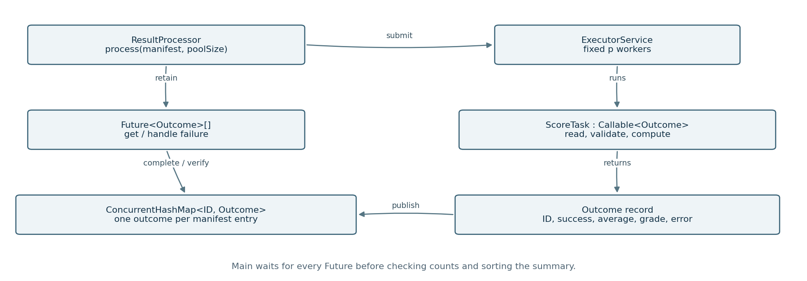
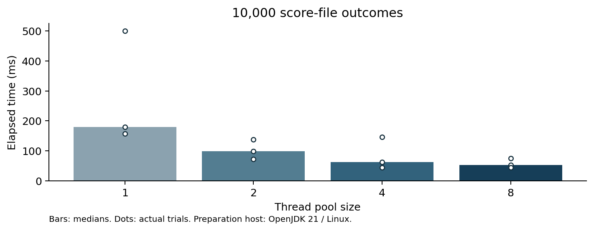

# ASSIGNMENT 3 - CO3
## Exception Handling and Multithreading
Programming in Java | CSA09 | Pair work | 50 marks

Student A name: ______________________________
Student A register number: ____________________
Student A GitHub URL: _________________________
Student B name: ______________________________
Student B register number: ____________________
Student B GitHub URL: _________________________
Submission date: _____________________________

## Validation and student completion
All normal Java sources compile. Correct implementations, original TODO completions, controlled failure demonstrations, debugger tracing and all requested pool sizes were executed in the preparation environment. Logs and timings are real observations on OpenJDK 21.0.13 / Linux; they are not claimed as either student's individual execution.
Both students must execute every question, capture their own screenshots, fill their identities and genuine contributions, and maintain separate repositories with progressive per-question commits. Thread schedules and timings can differ. Update the evidence and report with your own results before final submission.

## Report map
Q1: ATM exceptions and tracing. Q2: custom exceptions and chaining. Q3: resource safety and debugging. Q4: thread creation and life cycle. Q5: booking races and synchronization. Q6: deadlock and producer-consumer coordination. Q7: fault-tolerant parallel result processing. Student A, Student B and joint responsibilities are labelled throughout.


# Q1 - Handling failure in a bank ATM simulation
## Shared implementation
AtmDemo simulates a balance of Rs. 5,000 and a local card file containing account 1001. It reads account and amount from the console in interactive mode; its default mode runs seven repeatable cases. BigDecimal avoids binary floating-point money errors. All values are fake. Cash dispensing is represented by a printed message, not hardware interaction.
## Student A - Exception design

| Failure point | Exception type | Classification | Catch location |
|---|---|---|---|
| Account/amount contains letters | NumberFormatException | Unchecked | Multi-catch in withdraw |
| Zero/negative amount or excessive decimals | InvalidAmountException | Unchecked | Specific amount handler |
| Amount exceeds balance | InsufficientFundsException | Checked | Funds handler |
| Card file missing | NoSuchFileException | Checked IOException subtype | Multi-catch |
| Other file access failure | IOException | Checked | Final I/O handler |
| Unknown account | IllegalArgumentException | Unchecked | Account handler |
| VM exhaustion | OutOfMemoryError | Error; unchecked | Not treated as a recoverable withdrawal |
The multi-catch types NumberFormatException and NoSuchFileException are unrelated, so that union is legal. NumberFormatException and InvalidAmountException must be caught before their superclass IllegalArgumentException. NoSuchFileException must precede IOException. Finally runs after normal completion or exception propagation of this try statement and prints simulated session cleanup. It cannot promise cleanup after VM termination, System.exit or power loss, and it does not reverse an already-completed financial transaction.
## Student B - Tests and tracing
| Case | Input/path | Observed handler | Finally ran? |
|---|---|---|---|
| 1 | 1001, 500, existing card | SUCCESS; balance 4500.00 | Yes |
| 2 | abc, 500 | MULTI_CATCH: NumberFormatException | Yes |
| 3 | 1001, abc | MULTI_CATCH: NumberFormatException | Yes |
| 4 | 1001, -10 | INVALID_AMOUNT | Yes |
| 5 | 1001, 6000 | INSUFFICIENT_FUNDS | Yes |
| 6 | Missing card-reader file | MULTI_CATCH: NoSuchFileException | Yes |
| 7 | 9999, 100 | BAD_ACCOUNT | Yes |
Full output is in evidence/AtmDemo.txt. UncaughtDemo intentionally terminates with NumberFormatException. In its trace, the header names the main thread, exception and invalid value; NumberFormatException.forInputString constructs the exception; the two Integer.parseInt frames show library parsing calls; UncaughtDemo.parseAmount at line 2 identifies the application fault; UncaughtDemo.main at line 3 is the application entry point. Stack traces list the most recent call first. Library line numbers can vary with JDK version.
BroadCatch.java is intentionally excluded from the normal build. Compiling it separately produces "exception FileNotFoundException has already been caught": catch(Exception) already covers that subtype, making the following catch unreachable. The actual compiler transcript is included.
## Joint decision and alternative
Do not replace the specific handlers with one generic Exception catch inside the ATM logic: it loses distinct user remedies and can hide programming faults. A final application-boundary catch can log unexpected Exceptions, show a generic failure and preserve diagnostics, but it should not claim recovery from every Error.
Without exceptions: IF NOT scanner.hasNextLong() THEN return INVALID_ACCOUNT; read account; IF NOT scanner.hasNextBigDecimal() THEN return INVALID_AMOUNT; read amount; validate range, identity, funds and file status; return a typed result. hasNextInt is suitable for integer-only inputs, but money and account ranges may require other token methods. Prechecking file existence does not remove a race before opening it, so real I/O still requires failure handling. Error codes need checks at every caller and can be ignored; an enum/result object is clearer than multiple meanings of -1.
Input parsing costs O(L) for L characters in either approach. Returning a primitive code adds O(1) time/space. A normal Java exception typically captures a stack of depth d in O(d) time and memory; unwinding/handler search also depends on depth. A non-thrown path does not incur that trace allocation. Exact exception costs depend on JVM optimizations and should not be inferred from Big-O alone.


# Q2 - Custom exceptions and propagation in an examination portal
## Student A - Hierarchy and layer design

ExamException extends Exception. WindowClosedException, NotRegisteredException, AnswerTooLargeException and SubmissionStorageException are checked subclasses because callers must choose how to respond to expected submission failures. Invalid programmer arguments could instead use unchecked IllegalArgumentException. The supplied StorageDemo retains the original assignment class hierarchy; PortalDemo adds the remaining rules.
The controller checks the exam window; the service checks registration and the 500 KiB answer limit; storage copies the validated file. service declares throws ExamException, and storage declares throws SubmissionStorageException. A storage IOException is wrapped with its cause, propagates through service and is caught at the controller. The student sees "Could not store submission" while the diagnostic trace retains the low-level path and cause. This separates a stable domain message from filesystem details.

## Student B - Failure scenarios and chaining
| Scenario | Observed result |
|---|---|
| Open window, registered, small file | Submission accepted |
| Closed window | WindowClosedException |
| Unregistered student | NotRegisteredException |
| 500 KiB + 1 byte file | AnswerTooLargeException |
| Destination parent directory absent | SubmissionStorageException, caused by NoSuchFileException |
PortalDemo asserts these five results and prints the complete chained trace. getCause() returns the original IOException subtype, retaining its message and stack. Constructing new ExamException(e.getMessage()) instead yields getCause() = null: the original exception type, origin stack and causal relationship disappear. The deliberate demonstration prints both cases. File-size checking is an application rule and does not prevent a concurrently changing source; robust production storage should bound the actual streamed bytes and publish atomically.
## Completed scaffold
StorageDemo replaces only TODO 1 with throw new SubmissionStorageException("Could not store " + fileName, e). Actual output matches:
```text
Saved answer01.pdf
Error: Could not store answer02.pdf
Cause: Disk quota exceeded
```
If the wrapper has no cause, getCause() is null. The original scaffold then calls null.getMessage(), so it throws NullPointerException while constructing the Cause line; it does NOT print "Cause: null". A null-safe diagnostic could print that, but the given code is not null-safe.
## Joint conclusion and unchecked alternative
A meaningful storage exception lets the UI handle a submission failure without knowing the filesystem API, while retaining the original cause for maintenance. Do not show raw internal paths or full stack traces to ordinary users in a production portal; the local exercise prints them as diagnostic evidence.
If ExamException extends RuntimeException, callers are no longer forced to catch or declare it. The same throws clauses may remain as documentation, and the controller can still catch it, but compilation no longer enforces handling. Throwing and stack-capture cost is broadly the same for checked and unchecked exceptions with normal stack traces. A wrapper retains its own O(d1) trace plus a reference to the cause's O(d2) trace; a chain of k exceptions retains the sum of their trace/message memory, not merely one reference's size. The cause object is retained, not deep-copied.


# Q3 - Resource safety, debugging and robust sales reports
## Shared implementation and input
SalesDemo contains buggy manual closing, corrected manual try/catch/finally, and try-with-resources versions. Sales are integer paise. store1.txt totals 400 and store2.txt totals 500; the two corrected outputs are compared byte-for-byte and match. corrupt.txt fails on its second line, NOT_A_NUMBER. Logging identifies filename and line number.
## Student A - Debugging and experiments
An actual jdb session is saved in evidence/q3-debugger.txt. A method breakpoint stops inside SalesDemo.buggy; two next commands reach its loop. Before opening a reader the tracked-resource count is 1 (the writer). catch java.io.IOException stops on the corrupt input with total=100, n=2 and line="NOT_A_NUMBER". where shows sum -> buggy -> main. At that point two tracked file resources are open. Continuing runs the outer finally, closes the writer and leaves the corrupt-file reader open.
| Version on failing input | Tracked resources left open | Observation |
|---|---|---|
| Buggy manual | 1 | Reader close skipped after sum throws |
| Corrected manual finally | 0 | Reader and writer close on failure |
| Try-with-resources | 0 | Both resources closed automatically |
These counts track actual reader/writer wrappers opened by this program, not every OS descriptor owned by the JVM. Each wrapper owns one file stream. After measuring the intentional leak, the test explicitly closes it so repeated demonstrations do not exhaust the host. A single failing run leaks one reader; repeated buggy invocations can accumulate O(f) handles and eventually reach an OS limit.
## Student B - Design and correctness
The summary writer must close after the report attempt. Each input reader must close after its store, including parse failure. In the buggy version reader.close is after a statement that can throw; only the writer is in finally. The corrected manual version nests reader cleanup inside the writer cleanup and preserves primary errors by adding close failures as suppressed exceptions. It catches and rethrows Error only to preserve cleanup semantics, not to claim recovery.
Try-with-resources closes initialized resources in reverse acquisition order. A body exception remains primary; close failures are attached as suppressed exceptions. If no body failure occurs, the first close failure becomes primary and later close failures are suppressed. The BadClose experiment prints closing second before first, a primary "body failed" exception, and two suppressed close exceptions. Check getSuppressed() separately from getCause(): they describe different relationships. [R1]
## Joint decision and alternatives
Closing resources does not make an incomplete report correct. The failing versions deliberately leave a partial output containing the first store, so it must not be published as a complete report. Production strategy: write to a temporary file, validate totals and required stores, close successfully, then atomically replace the published report; retain the old report on failure. Also define missing-store policy, validation, permissions, retries, disk-full behavior and logging.
For f files with B total input bytes, sequential processing costs O(B+f) time; bounded numeric lines permit O(1) working memory excluding reports/logs. Both correct versions hold at most one input reader plus one writer, O(1) handles, and zero after exit. No-close processing can accumulate O(f) open handles. The demonstrated buggy version leaks one handle on one failure, but repeated failures accumulate. Explicit finally can be correct, yet the nested code and exception-preservation logic are much easier to get wrong than try-with-resources.


# Q4 - Thread creation and the thread life cycle
## Shared implementation
ScannerDemo implements four stations extending Thread, then four Runnable tasks wrapped in Thread objects. Every station scans ten scripts with a simulated 1 ms sleep per script. All workers start before main joins them; the expected final total is 40. Actual totals are asserted for every run. Ten normal Thread runs, ten priority experiments and ten Runnable runs are recorded in evidence/q4-orders.csv.
## Student A - Design and states
Thread inheritance combines task and thread identity and prevents extending another class. Runnable separates work from scheduling, supports composition and can be submitted to an ExecutorService; it is usually preferable for reusable tasks. The included fixed-pool example submits four Callable tasks and sums their returned counts through Future.get.

NEW precedes start. RUNNABLE includes running or ready-to-run at JVM level. sleep places a worker in TIMED_WAITING; a contended monitor can place it in BLOCKED. wait or untimed join can place the calling thread in WAITING; notification does not transfer lock ownership immediately. Completion leads to TERMINATED. Not every worker visits every state. In this scanning design workers alternate RUNNABLE and TIMED_WAITING; main may WAIT while joining. A transient state snapshot is not guaranteed to catch every state.
Calling direct.run() executes on the current main thread. The observed log says "run() executes on main" and the never-started Thread remains NEW with isAlive=false. start() creates concurrent execution and can be called only once per Thread. Successful join waits for termination and makes the worker's prior writes visible, so main reads each scanned counter safely after joining. It does not dictate completion order.
## Student B - Scheduler, priorities and daemon evidence
The full 30-order CSV is the evidence, including totals and the priority flag. Normal and priority runs can have different completion orders; priorities are scheduler hints, not a portable ordering contract. Station 1 is assigned MAX_PRIORITY and the other stations MIN_PRIORITY in the priority trials. No result computation depends on which finishes first.
The daemon experiment runs in a separate JVM. A latch confirms "daemon began" before main prints "main ends without joining daemon". The observed output has no "daemon completed": the JVM can exit when only daemon threads remain. Joining a daemon would change that behavior by keeping main alive until it finishes. Essential result or payment work must not rely on daemon completion.
## Joint conclusion and pool alternative
Scheduling, CPU load, OS policy, timer granularity and lock acquisition cause nondeterminism. A correct program waits for all required results and uses synchronization for shared state rather than relying on observed order. The synchronized finish-order list is shared; individual scan counts belong to one worker and are read after join.
For n balanced scripts taking t each and p workers, ideal processing time is O(n*t/p), plus startup, scheduling and aggregation; fixed overhead and I/O can dominate. Four Thread instances and a four-worker pool both use roughly four thread stacks, O(p*S) for stack size S. A pool reuses workers across repeated batches and prevents unbounded thread creation; its queue and Futures add O(number of tasks) memory. More workers than available useful parallelism may increase context switching instead of throughput.

## Recorded station completion order
Each row completes 40 scripts. A four-digit order lists station IDs in completion order.

| Trial | Thread normal | Thread priorities | Runnable |
|---|---|---|---|
| 1 | 1-2-4-3 | 2-1-4-3 | 1-2-4-3 |
| 2 | 3-1-2-4 | 1-4-3-2 | 1-2-4-3 |
| 3 | 1-2-4-3 | 2-1-3-4 | 1-3-2-4 |
| 4 | 2-1-4-3 | 3-2-1-4 | 2-3-4-1 |
| 5 | 1-3-2-4 | 1-2-3-4 | 1-2-3-4 |
| 6 | 1-2-3-4 | 1-2-3-4 | 1-3-4-2 |
| 7 | 1-2-3-4 | 1-3-2-4 | 1-2-3-4 |
| 8 | 1-2-3-4 | 1-2-3-4 | 1-2-4-3 |
| 9 | 1-2-3-4 | 1-2-3-4 | 1-2-3-4 |
| 10 | 1-2-3-4 | 2-1-3-4 | 1-2-3-4 |


# Q5 - Race conditions in cinema seat booking
## Shared implementation and completed scaffold
SeatBooking.java changes only TODO 1: synchronized book checks booked[seat], sets it true and increments bookingsMade under the same receiver monitor. The corrected scaffold prints Seats sold: 10. The separate unsafe folder contains the same class with only synchronized removed; it is compiled into a different directory so it does not collide with the correct class.
## Student A - Reproduce and explain the race
The original unsafe scaffold returned 10 in all ten preparation runs. This does not prove safety: thread startup often serializes short operations, and the unprotected bookingsMade++ can lose increments, masking duplicate sales. Keep the actual result rather than inventing a failure count.
BookingExperiment adds a separate controlled interleaving: two users both read one seat as free, meet at a CyclicBarrier, then both mark it sold. An independent AtomicInteger counts successful returns. This produced two accepted sales for one seat in all ten trials: one extra sale per trial. The barrier is experimental scheduling instrumentation, not a proposed booking implementation.
| Step | User A | User B |
|---|---|---|
| 1 | Reads seat as free | Not yet checked |
| 2 | Waits at barrier | Reads seat as free |
| 3 | Marks sold and records success | Leaves barrier |
| 4 | Already returned success | Marks sold and records success |
The exact critical section is the combined availability check and state change. Protecting only the increment or only the read is insufficient. The synchronized versions are correct because no second thread can interleave this critical section on the same screen lock; tests support this reasoning but do not prove all schedules by themselves.
## Student B - Compare synchronization strategies
The timing experiment makes 10,000 attempts on 100 seats using eight reusable pool workers, ten trials per strategy, rotating order. Task submission is outside the measured start gate; time includes worker release, booking and waiting for completion. Accepted-return counts use an atomic counter so a lost counting update cannot hide double booking. The unsafe variant deliberately yields between check and set to expose races; its timing is not a fair pure-lock-overhead comparison.
A synchronized instance method locks this. The block version locks a private per-screen object and covers only check/set. Here both critical sections contain essentially the same work, so small timing differences mostly reflect noise and runtime effects rather than a general performance advantage. Static synchronized locks the Class object, appropriate for truly class-wide shared state; it would unnecessarily serialize all screens if seat state is per screen.
## Joint deployment decision and alternatives
For 20 screens, use one lock/state owner per screen, with a small atomic booking section and no network/payment calls inside it. Across multiple application processes, a Java monitor is insufficient: enforce uniqueness and transactions in the authoritative database. Coordinate payment confirmation, holds and cancellations with idempotent booking IDs.
AtomicBoolean[seat].compareAndSet(false,true) replaces check/set with a per-seat atomic transition; use an atomic total counter if needed. The runnable alternative uses AtomicIntegerArray to avoid one object per boolean. ReentrantLock uses lock/try/finally/unlock and supports timed/interruptible acquisition. ConcurrentHashMap.putIfAbsent(seat, bookingId) gives expected O(1) lookup/claim and stores only booked seats. Each bounded-array operation has O(1) state work without waiting, but contention introduces unbounded scheduling/wait time; CAS is not a blanket guarantee that every thread completes within a fixed time. Space is O(s) for s seat flags/atomics, O(1) extra for one screen lock, or O(k) map entries for k booked seats, with object overhead. ConcurrentMap design still needs the correct screen+seat composite key.

## Measured booking timings
Preparation-host medians over ten trials; 10,000 attempts per trial.

| Strategy | Median ms | Total extra sales across 10 trials |
|---|---|---|
| unsafe | 9.432 | 2 |
| method | 8.723 | 0 |
| block | 5.174 | 0 |
| CAS | 9.824 | 0 |


Unsafe timings include Thread.yield and are only a behavior experiment. All synchronized/CAS trials accepted exactly 100 distinct seat claims.


# Q6 - Deadlock and inter-thread communication
## Shared work and completed scaffold
TokenCounter completes only the two TODOs: wait in a while loop while full/empty, insert/remove through ring-buffer indices modulo 5, adjust count, notifyAll and return the removed value. The original program prints Sum of tokens collected: 210 (expected 210). VariantsRunner executes its while-to-if variant ten times in separate JVMs with a three-second limit, so an intentionally broken demonstration cannot hang the run indefinitely.
## Student A - Producer-consumer design
The counter monitor guards the condition and mutation. wait must be called while owning that monitor or IllegalMonitorStateException occurs. wait atomically releases that monitor and suspends the caller. On wake-up the condition must be checked again because another consumer may have used the item first or a spurious wake-up may occur. notifyAll makes waiting threads eligible to compete; it does not let them bypass the lock or predicate. sleep delays the caller but does not release monitors it holds. [R2]
TokenExperiment uses two producers, three consumers and 80 distinct tokens. The correct version recorded 160 put/take events, collected every token exactly once and obtained sum 3240. The CSV records counter size while holding the monitor; every size is between 0 and 5.
The original if-scaffold happened to return 210 on all ten preparation runs. Under stronger contention, the separate if+notifyAll experiment produced nine 600 ms timeouts and one NoSuchElementException. A timeout means failure to finish within the test budget, not proof of permanent deadlock; underlying worker errors can also cause other workers to wait. An observed correct run does not remove the invalid one-check logic.
The while+notify experiment completed all ten observed runs. That is reported honestly rather than claiming notify always deadlocks. With one shared wait set and multiple producer/consumer conditions, notify may wake a thread whose predicate is still false while an eligible thread remains asleep. For example, consumers can drain available items and notify another consumer while a producer remains waiting on the previously-full condition; eventual all-empty waiting can then prevent progress. notifyAll plus while avoids choosing only the wrong kind of waiter. ArrayBlockingQueue uses separate condition coordination and is the less error-prone production choice.
## Student B - Reliable deadlock and prevention
DeadlockDemo uses two wallet locks and a latch: each thread holds its source wallet and waits for both first locks to be acquired before requesting the other wallet. ThreadMXBean detects two deadlocked threads and prints their lock owners/stacks. They are daemon threads in this isolated demonstration JVM; they remain blocked until exit, so they do not prevent the next test process from running.
All four conditions are present: mutual exclusion on each monitor, hold-and-wait while requesting the other, no preemption of a held monitor, and a circular wait A -> B -> A. The corrected transfer always acquires the smaller unique immutable wallet ID first and the larger second, independent of transfer direction. Every wait edge follows increasing ID, so a cycle cannot form. Real code must enforce distinct unique IDs, or add a tie-lock rule. Four workers complete 4,000 transfers on fresh wallets; the total remains 20,000.
## Joint progress argument and alternatives
Both problems coordinate threads sharing state and can lose progress if ownership/wake-up rules are wrong. Lock ordering prevents cyclic acquisition; guarded wait/notifyAll permits useful work once a state predicate becomes true. Neither ordinary monitor design promises strict fairness or immunity to worker cancellation.
ArrayBlockingQueue<Integer>(5) exposes put/take with bounded capacity; the included executable alternative obtains sum 210. Its queue mutation is O(1), space O(5), but blocking duration is unbounded when no counterpart progresses. notifyAll can wake O(w) waiting threads per change, adding contention; separate conditions can reduce needless wake-ups.
For transfers with ReentrantLock: acquire first with tryLock(timeout); try acquiring second within the remaining budget; if that fails release first in finally, back off and retry a bounded number of times; release both after success. Per-attempt state work is O(1), elapsed waiting is bounded by configured timeouts per attempt, and total work is O(r) for r retries. Uncoordinated retries can livelock or starve, so ordering plus bounded retries is safer. Locks add O(a) storage for a accounts, with O(1) local state per transfer.


# Q7 - Concurrent fault-tolerant semester result processing
## Stage 1 - Joint requirements
One file contains three comma-separated integer marks in 0..100. A valid file is successfully processed even if its academic grade is FAIL. A PASS requires every mark >=40; average is the arithmetic mean. These explicit project rules make the summary hand-checkable. File identity is its unique filename in the manifest; duplicates are rejected before scheduling.
Measurable requirements: process each of 10,000 manifest entries once; emit exactly one outcome per entry; classify all expected corrupt/missing files without stopping other tasks; verify successes + failures = manifest size; report timing for pools 1, 2, 4 and 8; retain error reasons; close per-file resources. The exercise specifies no fixed deadline, so speed is measured comparatively rather than inventing an SLA.
Reading/validating separate files and calculating per-student grades are parallel tasks. The input manifest is read-only. Results are shared through ConcurrentHashMap keyed by unique filename; individual task variables are local. Expected failures include missing/unreadable files, malformed integers, wrong field count and out-of-range marks. Other runtime failures appear through ExecutionException and become explicit failure outcomes. Fatal JVM Errors and main-thread interruption abort the run rather than claiming a complete successful summary.
## Stage 2 - Student A design

ScoreTask implements Callable<Outcome>. A fixed ExecutorService runs a bounded number of worker threads. Each wrapper publishes its task's Outcome into ConcurrentHashMap and returns it through a Future. Main waits on every Future; ordinary unexpected task exceptions produce a failure outcome under that task ID. The map avoids concurrent writes corrupting shared state and provides one slot per unique manifest entry. A nonconcurrent list collected only by main would also be valid, but would not demonstrate the selected shared concurrent collection.
```text
ALGORITHM PROCESS_RESULTS(Manifest, PoolSize)
BEGIN
    REJECT duplicate manifest IDs
    CREATE fixed executor and concurrent outcome map
    FOR EACH file in Manifest DO
        SUBMIT callable: read, validate, compute, publish one Outcome
        SAVE returned Future associated with that file
    ENDFOR
    FOR EACH saved Future DO
        TRY wait for completion
        ON expected/unexpected ordinary failure record failure for that ID
        ON interruption cancel pending tasks and report incomplete run
        ON fatal VM Error abort instead of promising recovery
    ENDFOR
    REQUIRE outcome count equals manifest count
    SORT outcomes by ID; COUNT success and failure
    SHUT DOWN executor; RETURN outcomes
END
```
Known I/O/validation failures are converted inside call; Future.get catches exceptions escaping that boundary. Completion of every Future is the synchronization point before summarization. The implementation shuts down in finally. At most p score reads are active, but Files.readString loads each entire file, so impose a file-size limit in production.
## Stage 3 - Student B implementation and evidence
| Small input | Content | Expected and observed |
|---|---|---|
| a.txt | 60,70,80 | Processed; average 70; PASS |
| b.txt | 30,40,50 | Processed; average 40; FAIL |
| c.txt | 40,40,40 | Processed; average 40; PASS |
| d.txt | 100,100,100 | Processed; average 100; PASS |
| corrupt.txt | oops | Processing failure |
| missing.txt | Intentionally absent | Processing failure |
The generator makes a 10,000-entry manifest; indices divisible by 100 are intentionally absent (100 files), and indices with remainder 1 contain CORRUPT (100 files). The other 9,800 contain 60,70,80. All 12 measured runs reported 9,800 successful processing outcomes and 200 failures. Assertions also verified 100 missing files, valid averages/grades and the small hand-checked results. No unhandled ordinary per-file failure was observed. Raw CSV and a complete 10,000-row summary are included; generated temporary input files are cleaned up after execution and can be reproduced by the generator.
Timing includes executor startup, task submission, reading, parsing, Future waiting, result-map processing, sorting and shutdown. Data generation and summary-file writing are outside the timing. Three trials rotate pool order; a short warmup occurs first. Inputs were just generated, so page-cache effects are substantial. These are host observations, not guarantees for a student's disk or a production server.
## Stage 4 - Joint defense and limitations
Recommend the pool with the best repeatable median for this workload, then repeat on the target machine with representative file sizes and storage. More threads do not guarantee improvement: I/O bandwidth, CPU parsing, task overhead, context switching and concurrent-map contention can dominate. The first trial already shows four threads slower than two, while later samples differ. Do not infer a universal winner from one run.
A complete normal-run summary follows from unique IDs, one task per entry, a returned or explicitly failed outcome for every Future, waiting for all tasks and asserting the map size. It does not guarantee completion after process crash, fatal error, indefinitely blocked I/O or forced cancellation. Remaining limitations: all Futures/outcomes and the unbounded executor work queue cost O(n); whole-file reads are unbounded; results are not checkpointed for recovery. For larger production workloads use a bounded submission window, size limits, deadlines and durable checkpoints.
## Alternative designs and complexity
parallelStream can map each path through the same local failure-to-Outcome function and collect the results. Without local handling one unchecked failure can abort the terminal operation. Its default shared common pool is less explicit for blocking I/O and competes with unrelated users of that pool.
One platform Thread per file can run the same guarded task, but 10,000 stacks require O(n*S) memory and heavy scheduling overhead. The fixed pool uses O(p*S) stack memory plus O(n) tasks/Futures/results and O(p*L) active file content for maximum file size L. Total input-processing work is O(B+n) for B bytes; ideal parallel time approaches O(B/p) subject to I/O and scheduling limits. This implementation additionally sorts results in O(n log n), which is included in timing and must not be omitted from its total complexity.

## Measured pool-size comparison
Three trials per pool; milliseconds, on OpenJDK 21.0.13 / Linux.

| Pool | Trial 1 | Trial 2 | Trial 3 | Median ms |
|---|---|---|---|---|
| 1 | 500.892 | 157.099 | 179.238 | 179.238 |
| 2 | 137.488 | 72.525 | 98.800 | 98.800 |
| 4 | 145.872 | 44.223 | 63.164 | 63.164 |
| 8 | 75.134 | 52.164 | 44.611 | 52.164 |

The observed best median was pool 8 (52.164 ms). Use 8 as the starting recommendation for this measured local workload, then validate on the deployment machine.




# Individual contribution record - complete after doing the work
Student A: __________________  Register: __________________
Student B: __________________  Register: __________________
Both students must participate in every question and execute all programs individually.
The responsibilities below are assigned roles, NOT a claim that the work has been performed.

| Question | Student A primary responsibility | Student B primary responsibility | Joint responsibility |
|---|---|---|---|
| Q1 | Exception hierarchy, classification, catch order, finally | Test paths, uncaught trace, unreachable catch | Evaluate generic catch and validation alternative |
| Q2 | Custom hierarchy and propagation design | Failure scenarios and chaining evidence | Explain domain exception translation |
| Q3 | Debugger session, failing input, leak counts and logs | Resource ownership, closing order, suppressed errors | Robust publication and resource strategy |
| Q4 | Thread/Runnable design, states, run vs start, join | Ten-run order, priority and daemon experiments | Explain scheduler independence |
| Q5 | Controlled race, counts, interleaving, critical section | 10,000-attempt measurements and lock comparison | Choose per-screen synchronization |
| Q6 | Producer-consumer predicates, wakeups and capacity | Reliable deadlock and ordered-lock prevention | Explain safety and progress |
| Q7 | Callable/Future/concurrent-map design and pseudocode | Inject files, measure pools, verify counts | Requirements, pool choice and limitations |

For EACH row record your actual actions, date, screenshot/log path and commit URL below. Do not sign before checking the work.
Q1 actual work/evidence: __________________
Q2 actual work/evidence: __________________
Q3 actual work/evidence: __________________
Q4 actual work/evidence: __________________
Q5 actual work/evidence: __________________
Q6 actual work/evidence: __________________
Q7 actual work/evidence: __________________
Student A signature/date: __________________
Student B signature/date: __________________


# References and evidence index
[R1] Oracle, The try-with-resources Statement. https://docs.oracle.com/javase/tutorial/essential/exceptions/tryResourceClose.html
[R2] Oracle Java SE 21, Object: wait/notify/notifyAll. https://docs.oracle.com/en/java/javase/21/docs/api/java.base/java/lang/Object.html
Additional API reference: Java SE 21 java.util.concurrent and java.lang.management APIs. https://docs.oracle.com/en/java/javase/21/docs/api/
Assignment requirements: supplied ASSIGNMENT3.pdf, Programming in Java, CO3.

## Evidence locations
Q1: AtmDemo.txt, uncaught-stack.txt, invalid-catch.txt.
Q2: StorageDemo.txt and PortalDemo.txt, including chained trace.
Q3: SalesDemo.txt, q3-debugger.txt and generated report CSVs.
Q4: ScannerDemo.txt, daemon.txt and q4-orders.csv.
Q5: SeatBooking.txt, unsafe-scaffold.txt, q5-forced-race.csv and q5-bookings.csv.
Q6: TokenCounter.txt, DeadlockDemo.txt, TokenExperiment.txt, if-scaffold.txt and q6-counter-sizes.csv.
Q7: ResultProcessor.txt, q7-timings.csv, q7-small-results.csv and q7-all-results.csv.
Every file is under evidence, with question-local copies supplied. Keep raw logs even when a chart or summary table is included. Replace/update task-local copies after your own rerun.
